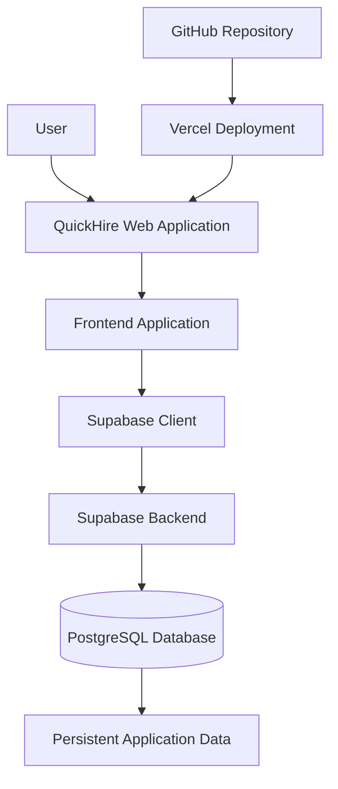
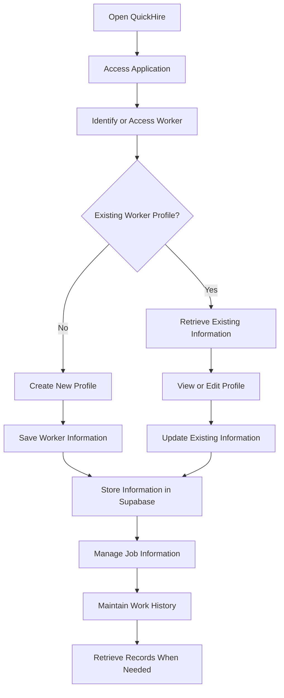
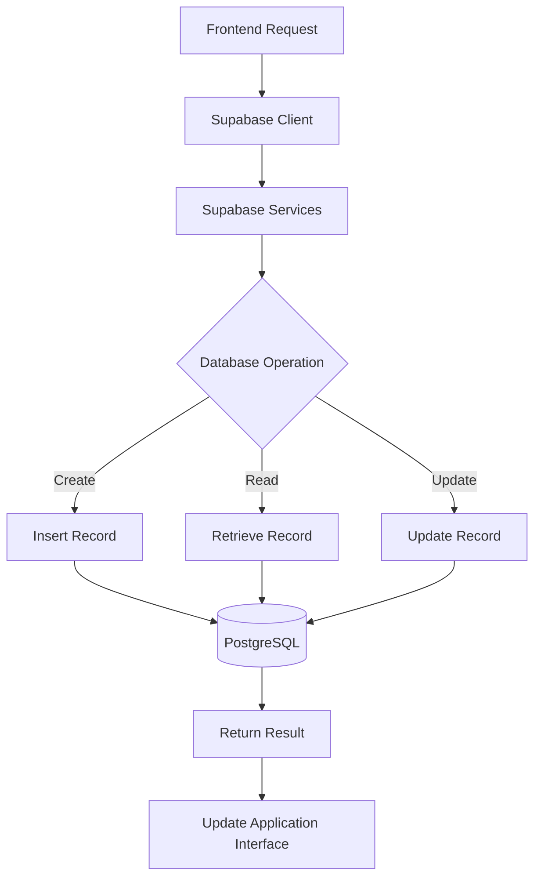
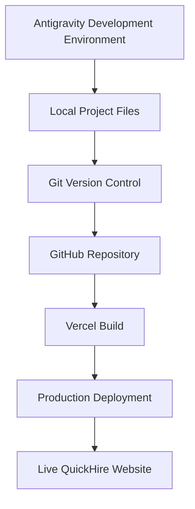

# 🚀 QuickHire

### Connecting People with Skilled Workers

A centralized platform for worker profiles, job management, and work history.

🌐 [Live Website](https://quick-hire-khaki.vercel.app) |
📂 [GitHub Repository](https://github.com/mayank-dhawad/Quick-Hire) |
👨‍💻 [Developer Profile](https://github.com/mayank-dhawad)

---

## 📌 Project Overview

**QuickHire** is a web-based platform developed to simplify worker management and organize information related to skilled workers and their jobs.

The platform aims to provide a centralized digital environment where worker profiles can be created, saved, accessed, and updated, while maintaining relevant job information and work history.

Instead of repeatedly entering the same worker information, QuickHire is designed around persistent data storage, allowing previously saved records to be retrieved and maintained.

The project integrates **Supabase** for backend and database services, **GitHub** for source code management, and **Vercel** for hosting and deployment.

### 🌐 Project Information

| Detail             | Information                                                        |
| ------------------ | ------------------------------------------------------------------ |
| Project Name       | QuickHire                                                          |
| Project Type       | Web Application                                                    |
| Repository         | [Quick-Hire](https://github.com/mayank-dhawad/Quick-Hire)          |
| Repository Owner   | Mayank Dhawad                                                      |
| Development        | Individual Project                                                 |
| Backend & Database | Supabase                                                           |
| Deployment         | Vercel                                                             |
| Live Website       | [quick-hire-khaki.vercel.app](https://quick-hire-khaki.vercel.app) |
| Version Control    | Git & GitHub                                                       |

---

## 🎯 Problem Statement

Managing workers and their associated job information can become difficult when records are maintained manually or across different platforms.

Some common challenges include:

- Maintaining worker information in an organized manner.
- Repeatedly entering information for previously registered workers.
- Difficulty accessing previously saved worker profiles.
- Keeping track of completed jobs and work history.
- Maintaining consistent records over multiple sessions.
- Managing worker-related information through disconnected processes.

## 💡 Proposed Solution

QuickHire provides a centralized web application designed to make worker information and job-related records easier to manage.

The application focuses on:

- Creating and maintaining worker profiles.
- Retrieving previously saved worker information.
- Updating existing profiles instead of creating duplicate records.
- Organizing worker-related job information.
- Maintaining access to relevant work history.
- Using a persistent database for storing application information.

The objective is to make worker management more organized, accessible, and efficient.

---

# ✨ Key Features

## 1. Worker Profile Management

Create and maintain individual worker profiles with relevant personal and professional information.

## 2. Profile Creation and Editing

Save worker information when a profile is created for the first time and access the existing profile for subsequent updates.

## 3. Phone Number-Based Identification

Use the registered phone number within the application's identification and access workflow to locate previously associated worker information.

## 4. Persistent Data Storage

Store application information in Supabase so saved records can remain available across browser sessions.

## 5. Returning User Data Access

Retrieve previously associated worker information when the user returns using the same registered number, according to the implemented authentication flow.

## 6. Job Management

Maintain information associated with workers and their job-related activities.

## 7. Work History Management

Keep track of previously completed work and access relevant historical records.

## 8. Centralized Database Management

Maintain application records in a centralized database instead of relying entirely on temporary browser storage.

## 9. Web-Based Accessibility

Access the application through a web browser without requiring a separate desktop installation.

---

# 🛠️ Technology Stack

QuickHire uses development tools and cloud services to support its application development, database integration, collaboration, and deployment.

| Technology  | Role                                          |
| ----------- | --------------------------------------------- |
| Antigravity | Development environment                       |
| Supabase    | Backend services and database integration     |
| PostgreSQL  | Relational database                           |
| Git         | Version control                               |
| GitHub      | Source code hosting and repository management |
| Vercel      | Application hosting and deployment            |

*The exact frontend framework, programming languages, and supporting libraries should be added after verifying the repository's source files and `package.json`.*

---

# 🏗️ System Architecture

QuickHire follows a web application architecture in which the frontend communicates with Supabase to store, retrieve, and update application data.

## High-Level Architecture



## Architecture Components

| Component       | Responsibility                             |
| --------------- | ------------------------------------------ |
| User            | Interacts with the application             |
| Web Application | Provides access to QuickHire               |
| Frontend        | Handles interface and user interactions    |
| Supabase Client | Connects the frontend to Supabase services |
| Supabase        | Provides backend and database services     |
| PostgreSQL      | Stores structured application records      |
| GitHub          | Maintains source code and version history  |
| Vercel          | Builds and hosts the live application      |

## Application Architecture Explanation

1. The user accesses the QuickHire web application.
2. The frontend handles user interactions and application functionality.
3. The configured Supabase client communicates with the backend.
4. Supabase processes the relevant database operations.
5. PostgreSQL stores and retrieves the application information.
6. The frontend displays the resulting information to the user.

---

# 🔄 Application Workflow

The general worker-management workflow is illustrated below.



This diagram represents the intended application workflow. Actual authentication, validation, and database operations depend on the implemented code.

---

# 🗄️ Database Architecture

QuickHire uses **Supabase**, which provides a PostgreSQL database and backend services.

The database is responsible for maintaining structured application information and supporting persistent data operations.

## Database Responsibilities

- Store worker profile information.
- Maintain relevant worker records.
- Support profile creation and updates.
- Store job-related information.
- Maintain associated work-history records.
- Support retrieval of previously stored information.

## Database Operation Flow



## Database Management

The Supabase dashboard can be used to manage:

- Database tables.
- Table relationships.
- Columns and data types.
- Constraints and indexes.
- Row Level Security policies.
- Database functions and SQL migrations.

**Important:** The actual database schema should be documented using the real table names and relationships from your Supabase project rather than assumed table names.

---

# 🔐 Authentication and Data Access

Worker identification and access to previously stored information are important parts of QuickHire's intended workflow.

The application should ensure that:

- Existing worker information can be associated with the correct registered identity.
- Previously saved records can be retrieved.
- Profile updates affect the intended existing record.
- Unauthorized users cannot access another user's private information.
- Database permissions are enforced through appropriate security policies.

Phone number identification should not be treated as proof of authentication by itself. Access to private records should be protected through the application's actual authentication and authorization mechanisms.

---

# 📂 Repository Information

The project source code is maintained in the following GitHub repository:

**Repository:** [mayank-dhawad/Quick-Hire](https://github.com/mayank-dhawad/Quick-Hire)

```bash
git clone https://github.com/mayank-dhawad/Quick-Hire.git
```

The repository contains the application source code and project configuration required for development and deployment.

---

# 💻 Getting Started

Follow these instructions to set up the project locally.

## Prerequisites

Before starting, make sure you have:

- Node.js installed, if required by the project.
- npm or the package manager used by the repository.
- Git installed.
- A GitHub account.
- Access to the configured Supabase project.

## 1. Clone the Repository

```bash
git clone https://github.com/mayank-dhawad/Quick-Hire.git
```

## 2. Open the Project Directory

```bash
cd Quick-Hire
```

## 3. Install Dependencies

For an npm-based project:

```bash
npm install
```

## 4. Configure Environment Variables

Create the environment file expected by the application and add the required Supabase configuration.

Refer to the environment configuration section below.

## 5. Run the Development Server

Use the development command defined in the project's `package.json`.

For an npm project with a `dev` script:

```bash
npm run dev
```

Open the local URL displayed in your terminal.

*Note: The commands above assume a root-level npm application. Verify the actual project scripts and directory structure before running them.*

---

# ⚙️ Environment Configuration

QuickHire requires the appropriate environment configuration to communicate with its Supabase project.

Typical Supabase configuration values include:

| Variable                            | Description                               |
| ----------------------------------- | ----------------------------------------- |
| Supabase Project URL                | Identifies the Supabase project           |
| Supabase Publishable Key / Anon Key | Public client key used by the application |

Example configuration template:

```env
# Supabase Configuration
YOUR_SUPABASE_URL_VARIABLE=your_supabase_project_url
YOUR_SUPABASE_PUBLIC_KEY_VARIABLE=your_supabase_public_key
```

Replace the example variable names with the exact names referenced in your application source code.

### Environment Variable Security

- Never commit private `.env` files to GitHub.
- Never expose Supabase service-role credentials in frontend code.
- Keep production environment variables configured in Vercel.
- Apply appropriate Row Level Security policies.
- Do not store sensitive credentials directly in source files.

---

# ☁️ Deployment Architecture

QuickHire is deployed using Vercel and connected to its GitHub repository.

The development and deployment workflow is:



## Deployment Steps

1. Make changes to the application.
2. Save the updated project files.
3. Test the application locally.
4. Commit and push the changes to GitHub.
5. Vercel detects the new commit on the connected deployment branch.
6. Vercel builds and deploys the updated application.
7. Verify the latest deployment on the live website.

### Git Commands

```bash
git status
git add .
git commit -m "Update QuickHire application"
git push origin main
```

Check your current branch before pushing. These commands assume the production branch is `main`.

### Live Deployment

🌐 [**Open QuickHire**](https://quick-hire-khaki.vercel.app)

### Important Deployment Information

Frontend deployments and Supabase database changes are separate operations unless an automated migration workflow is configured.

For database changes:

1. Prepare the SQL migration.
2. Review the database changes.
3. Apply them to the correct Supabase project.
4. Verify database permissions and policies.
5. Deploy compatible frontend changes.
6. Test the complete application workflow.

---

# 🧪 Testing and Verification

The following areas should be included in the project's testing process.

| Test Case               | Expected Result                                     |
| ----------------------- | --------------------------------------------------- |
| New Worker Profile      | Profile information is saved                        |
| Existing Worker Profile | Previously saved information is retrieved           |
| Profile Editing         | Existing information is updated                     |
| Data Persistence        | Information remains available across sessions       |
| Worker Identification   | Correct associated records are retrieved            |
| Job Management          | Relevant job information is maintained              |
| Work History            | Previous work records can be accessed               |
| Database Connectivity   | Application communicates successfully with Supabase |
| Deployment              | Latest successful application version is accessible |

Testing should cover both frontend interactions and the corresponding database operations.

---

# 🔒 Security Considerations

Security and data protection are important because the application may handle personal and professional worker information.

Recommended security practices include:

- Enabling appropriate Row Level Security policies.
- Applying authentication and authorization checks.
- Validating user input.
- Protecting private environment variables.
- Restricting access to records based on ownership.
- Avoiding exposure of private worker information.
- Reviewing database permissions before production deployment.

---

# 🚀 Future Scope

QuickHire can be expanded with additional features to improve the overall worker-management experience.

Potential future enhancements include:

- Advanced worker search and filtering.
- Worker availability management.
- Improved job tracking.
- Notifications and status updates.
- Enhanced dashboards and analytics.
- Detailed worker activity reports.
- Improved account and authentication management.
- Additional mobile usability improvements.

These are potential enhancements and are not claims of currently implemented functionality.

---

# 👨‍💻 Project Owner & Developer

### Mayank Dhawad

**Founder | Project Owner | Sole Developer | Maintainer**

QuickHire is an individually owned and developed project.

All project development, implementation, database integration, repository management, deployment, and ongoing maintenance are handled independently by Mayank Dhawad.

- **GitHub:** [@mayank-dhawad](https://github.com/mayank-dhawad)
- **Repository:** [Quick-Hire](https://github.com/mayank-dhawad/Quick-Hire)
- **Live Application:** [QuickHire](https://quick-hire-khaki.vercel.app)

---

# 📄 License

No formal open-source license has been specified for this repository.

Unless a license is added, the project should not be assumed to grant permission for redistribution, modification, or commercial reuse.

---

### QuickHire 🚀

Simplifying Worker Management Through Technology.

**Developed and maintained independently by Mayank Dhawad.**


